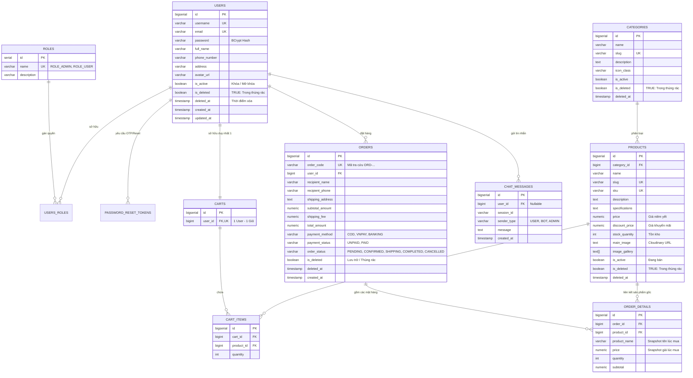

# HƯỚNG DẪN THIẾT KẾ VÀ KẾT NỐI DATABASE SUPABASE - DỰ ÁN SHOPTECH

Tài liệu này hướng dẫn toàn bộ thiết kế cơ sở dữ liệu (PostgreSQL trên Supabase), giải thích cơ chế **Thùng rác (Soft Delete / Trash Bin)** chuyên nghiệp, cấu trúc dữ liệu mẫu và các bước kết nối với dự án Spring Boot ShopTech.

---

## 1. Sơ Đồ Quan Hệ Thực Thể (ERD) & Cơ Chế Thùng Rác



---

## 2. Điểm Nhấn Kiến Trúc: Cơ Chế "Thùng Rác" (Trash Bin / Soft Delete)

Việc **KHÔNG XOÁ CỨNG (Hard Delete)** trực tiếp khỏi database đem lại các lợi thế vượt trội:

### A. Vì sao không xoá cứng?
1. **Bảo vệ toàn vẹn dữ liệu đơn hàng (Foreign Key Integrity)**:
   Nếu admin xoá cứng một User hay một Product đã từng có đơn hàng trong quá khứ, toàn bộ bảng `orders` và `order_details` sẽ bị lỗi ràng buộc khoá ngoại hoặc mất dấu vết mua hàng.
2. **Khả năng "Khôi phục" (Restore)**:
   Nếu Admin lỡ tay ấn xoá hoặc muốn mở bán lại một sản phẩm sau mùa dịch/ngừng kinh doanh, chỉ cần bấm **Khôi phục** (`is_deleted = FALSE, deleted_at = NULL`).
3. **Audit Log & Pháp lý**:
   Biết chính xác mặt hàng nào bị xoá lúc mấy giờ (`deleted_at`), đảm bảo dữ liệu kế toán và thống kê doanh thu luôn chính xác 100%.

### B. Quy trình hoạt động của Thùng rác:
- **Xoá tạm vào thùng rác**:
  ```sql
  UPDATE products SET is_deleted = TRUE, deleted_at = CURRENT_TIMESTAMP WHERE id = :id;
  ```
- **Khôi phục lại**:
  ```sql
  UPDATE products SET is_deleted = FALSE, deleted_at = NULL WHERE id = :id;
  ```
- **Xoá vĩnh viễn (Chỉ trong màn hình Thùng rác khi thực sự muốn dọn dẹp)**:
  ```sql
  DELETE FROM products WHERE id = :id AND is_deleted = TRUE;
  ```

### C. Cách tích hợp cực dễ trong Spring Boot Entity:
Trong Hibernate 6 / Spring Boot 3+:
```java
@Entity
@Table(name = "products")
@SQLDelete(sql = "UPDATE products SET is_deleted = true, deleted_at = CURRENT_TIMESTAMP WHERE id = ?")
@SQLRestriction("is_deleted = false") // Tự động chỉ query các sản phẩm chưa bị xoá
public class Product {
    @Id
    @GeneratedValue(strategy = GenerationType.IDENTITY)
    private Long id;

    private String name;
    
    @Column(name = "is_deleted")
    private Boolean isDeleted = false;

    @Column(name = "deleted_at")
    private LocalDateTime deletedAt;
    // ...
}
```

Khi Admin vào tab **Thùng rác (Trash Bin)**, bạn chỉ cần viết 1 method riêng trong Spring Data Repository:
```java
@Query(value = "SELECT * FROM products WHERE is_deleted = true ORDER BY deleted_at DESC", nativeQuery = true)
List<Product> findTrashProducts();
```

---

## 3. Các Bước Nạp Dữ Liệu Lên Supabase

Các file SQL đã được lưu sẵn trong thư mục dự án tại:
- Schema: [`src/main/resources/db/schema.sql`](file:///d:/shoptech/shoptech/src/main/resources/db/schema.sql)
- Data mẫu: [`src/main/resources/db/data.sql`](file:///d:/shoptech/shoptech/src/main/resources/db/data.sql)

### Thực hiện:
1. Đăng nhập vào [Supabase Dashboard](https://supabase.com/dashboard) và chọn Project của bạn.
2. Ở thanh menu bên trái, nhấp vào biểu tượng **SQL Editor** (biểu tượng `>_`).
3. Mở file [`schema.sql`](file:///d:/shoptech/shoptech/src/main/resources/db/schema.sql), sao chép toàn bộ nội dung dán vào SQL Editor và nhấn nút **Run** (báo `Success`).
4. Tiếp theo, mở file [`data.sql`](file:///d:/shoptech/shoptech/src/main/resources/db/data.sql), dán vào SQL Editor và nhấn **Run**.
5. Nhấp vào mục **Table Editor** ở menu bên trái để kiểm tra.

### Dữ liệu kiểm thử thùng rác có sẵn:
- **Tài khoản trong thùng rác**: `username = phamthid` (`is_deleted = TRUE`, `deleted_at = '2026-09-12'`).
- **Danh mục trong thùng rác**: `Máy In & Máy Scan Cũ` (`is_deleted = TRUE`).
- **Sản phẩm trong thùng rác**: `iPhone 11 64GB - Hàng Cũ (Ngừng kinh doanh)` (`is_deleted = TRUE`, `deleted_at = '2026-09-14'`).
- Nhờ có sẵn data này, khi nhóm dựng giao diện trang **Thùng rác**, các bạn có ngay dữ liệu mẫu để test các nút **"Khôi phục" (Restore)** và **"Xoá vĩnh viễn" (Permanent Delete)**!

---

## 4. Hướng Dẫn Kết Nối Spring Boot Với Supabase

### Bước 1: Lấy chuỗi kết nối từ Supabase
1. Trên Supabase Dashboard, vào **Project Settings** -> chọn mục **Database**.
2. Cuộn xuống phần **Connection string**, chọn tab **JDBC**.
3. Chọn một trong hai phương thức:
   - **Session Pooler (Port 6543) - KHUYÊN DÙNG (Chống chặn mạng IPv4 ở VN)**:
     ```
     jdbc:postgresql://aws-0-ap-southeast-1.pooler.supabase.com:6543/postgres?sslmode=require
     ```
     Username thường có dạng: `postgres.[YOUR-PROJECT-REF]`
   - **Direct Connection (Port 5432)**:
     ```
     jdbc:postgresql://db.[YOUR-PROJECT-REF].supabase.co:5432/postgres?sslmode=require
     ```
     Username: `postgres`

### Bước 2: Cấu hình trong `application.properties`
Mở file [`application.properties`](file:///d:/shoptech/shoptech/src/main/resources/application.properties):
```properties
spring.datasource.url=jdbc:postgresql://db.[YOUR_PROJECT_REF].supabase.co:5432/postgres?sslmode=require
spring.datasource.username=postgres
spring.datasource.password=YOUR_SUPABASE_PASSWORD
spring.datasource.driver-class-name=org.postgresql.Driver

# Cấu hình Pooler HikariCP chống ngắt kết nối idle
spring.datasource.hikari.maximum-pool-size=10
spring.datasource.hikari.minimum-idle=2
spring.datasource.hikari.idle-timeout=300000
spring.datasource.hikari.max-lifetime=600000
spring.datasource.hikari.connection-timeout=20000
spring.datasource.hikari.keepalive-time=45000

spring.jpa.hibernate.ddl-auto=update
```

---

## 5. Sửa lỗi kiểu dữ liệu `users.username` trên database hiện có

Nếu log PostgreSQL có lỗi như:

```text
invalid input syntax for type bigint: "admin"
```

thì cột `users.username` trên database đang là kiểu số, không khớp với ứng dụng
(ứng dụng lưu tên đăng nhập dạng chuỗi). Dòng `Secured GET /error` thường chỉ
là log xuất hiện sau khi request gốc thất bại, không phải nguyên nhân.

### Kiểm tra kiểu cột

Chạy câu lệnh sau trong Supabase SQL Editor:

```sql
SELECT table_schema, data_type, character_maximum_length
FROM information_schema.columns
WHERE table_name = 'users'
  AND column_name = 'username';
```

Nếu kết quả là `bigint`, trước khi sửa hãy kiểm tra đúng schema/database và tạo
bản sao lưu. Câu lệnh sau chuyển các giá trị hiện có thành chuỗi, không xóa dữ
liệu:

```sql
ALTER TABLE public.users
    ALTER COLUMN username TYPE VARCHAR(50)
    USING username::text;
```

Nếu câu truy vấn kiểm tra trả về schema khác `public`, thay `public` trong câu
lệnh `ALTER TABLE` bằng schema thực tế. Sau khi chạy, xác nhận kiểu cột là
`character varying`, rồi khởi động lại ứng dụng và đăng nhập lại.

Không chạy lại `schema.sql` trên database đang có dữ liệu: file đó tạo lại schema
và có các lệnh xóa bảng.
